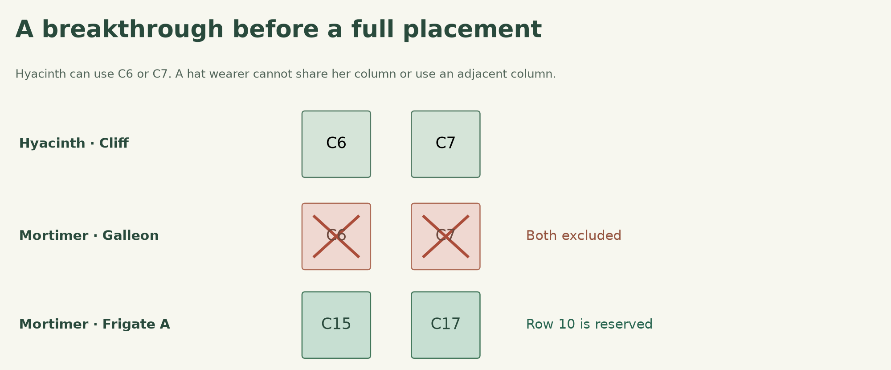
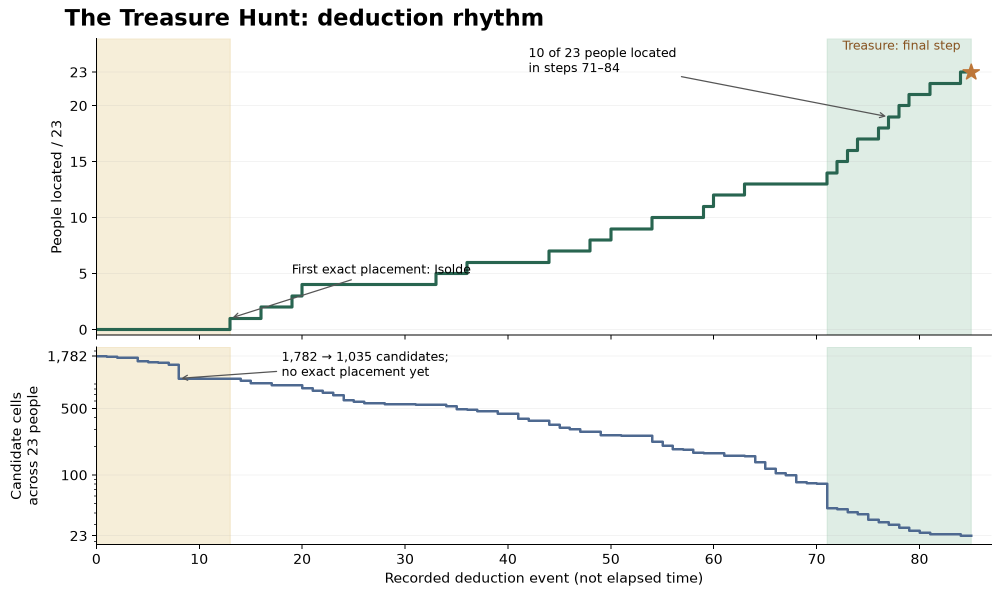

# How we solved the Treasure Hunt in 20 minutes

and built a workshop for endless puzzles

Manuel Garand confirmed that we were the first to submit the correct answer to the official Murdoku Treasure Hunt. Our solve took about 20 minutes.

We are fans of Murdoku. A board full of characters, objects and little clues can keep us busy for hours. We wanted more cases to play. Could we build a workshop that keeps making them, with new settings and clues, and the same care for how a puzzle comes together?

That is what we are building with **Murdoku Lab**. It generates detective puzzles, verifies their solutions and turns them into playable cases. You can also export each case as a text or visual query for an agent.

[Play a case](https://everywheresafety.github.io/murdoku/play/) · [GitHub](https://github.com/EverywhereSafety/murdoku-lab) · [Queries and rollouts](https://huggingface.co/datasets/EverywhereSafety/murdoku-lab)

## How we solved the contest

The Treasure Hunt has a 24×24 island, 23 people and a hidden treasure. Ships, cabins, clothing and objects all matter to the clues.

Our [Murdoku Detective 4B](https://huggingface.co/EverywhereSafety/murdoku-detective-4b), trained on generated Murdoku puzzles, read the PDF, transcribed the map and clues, and wrote an OR-Tools CP-SAT program to solve the puzzle.

The puzzle also gave us a useful example to study. Our deduction trace makes progress well before the first exact placement. Later, ten characters become located within fourteen deduction events. Those are things we want to look for in the puzzles we generate too. The detailed contest analysis is folded away below for readers avoiding spoilers.

## Build a case with an answer we can check

The generator starts with a board, objects, character placements and constraints. Solvers verify that the clues determine a unique solution. We keep that solution as the answer key.

The semantic setter adds the setting, names, room labels and clue wording. The answer is already established when this happens. Each themed case is checked against its formal puzzle before export.

This is an instance of [VHD-Play](https://arxiv.org/abs/2609.27321). A solved formal mechanism supplies the structure and gold reward reference. The setter turns it into a semantically diverse experience. In Murdoku Lab, that experience is a mystery you can play.

## More than a change of names

A climbing gym, a robotics laboratory and a music school give the clues different things to talk about. We vary room layouts, terrain, furniture, character attributes and clue relationships along with the setting and wording.

The larger scene presets give regions distinct roles. A library gets shelves and chairs. A garden gets connected patches of water. A courtyard manor has rooms around a cloister, with furniture and clear doorways. These details are built into the scene before character placements and clues are chosen.

The generator supports boards up to 24×24 in its larger puzzle families. Text and visual exports describe the same case and use the same answer key.

## Make the clues worth following

A unique answer is the starting point. We also want players to find a way in, make useful discoveries and have a reason to keep going.

We record deduction traces and measure the first placement, the longest gap between placements and the longest chain of consecutive placements. We also track partial discoveries, such as narrowing someone to one room or reserving a row. The generator can screen cases across several deduction orders using these measurements.

Below are 96 generated cases, with 12 in each combination of board sizes 6–9 and medium or hard difficulty. Text and visual versions count as one case.

| Board | Difficulty | First placement | Longest placement gap | Longest placement chain |
| --- | --- | --- | --- | --- |
| 6×6 | Medium | 4.5 | 2 | 4 |
| 6×6 | Hard | 8 | 2.5 | 4 |
| 7×7 | Medium | 4 | 3 | 3 |
| 7×7 | Hard | 5.5 | 3.5 | 3 |
| 8×8 | Medium | 2.5 | 4 | 4 |
| 8×8 | Hard | 6 | 2.5 | 3 |
| 9×9 | Medium | 2 | 5.5 | 4 |
| 9×9 | Hard | 2 | 6.5 | 5 |

These are median deduction-step counts from the canonical solver. The 9×9 cases in this sample often start quickly and then leave longer gaps. That gives us something specific to work on when selecting a collection. Actual play helps us decide which patterns are enjoyable.

[Measurement definitions](https://github.com/EverywhereSafety/murdoku-lab/blob/main/docs/reference/reasoning-profiles.md#generated-query-sample) · [Aggregate measurements](assets/puzzle-rhythm.json)

## A closer look at the Treasure Hunt

**Spoiler warning.** The optional section below discusses named characters and the order of discoveries in the official contest. It does not give the treasure coordinates.

Show the contest deductions and rhythm analysis

Hyacinth can only occupy Cliff columns 6 or 7. A hat wearer cannot share her column or use an adjacent column. Mortimer's Galleon candidates are all in columns 6 or 7, so they disappear. His remaining candidates are on Frigate A in row 10. That row reservation then narrows other characters' possibilities.

This is a breakthrough without an exact placement. Counting only fully located characters would miss it.

Our recorded trace reduced the initial 1,782 candidate cells to 1,035 through cheap propagation before fixing anyone. The first exact placement appeared at event 13. Ten of the 23 people became fixed in events 71–84, and the treasure was determined at event 85.

Eight character-processing orders retained the broad pattern, with the treasure determined at event 84 or 85. The trace includes bounded contradiction checks. Its events describe one solver's reasoning procedure rather than elapsed time or a reconstruction of every human deduction. The generated-case figure above uses a different observer, so its raw step counts should be read separately.

## Use the workshop

The repo brings together the generator, solver, text and visual renderers, and playable frontend. Generate a case, inspect its deductions, export both views or open it in the browser.

The browser supports candidate notes, personal exclusions, undo and redo, clue highlighting, zoom and pan. Placing someone crosses out the rest of their row and column. You can peek at the objects under a character without moving them.

The same cases can be used as agent tasks. The environment provides observations and tools, and checks submissions against the verified solution. Our [Hugging Face dataset](https://huggingface.co/datasets/EverywhereSafety/murdoku-lab) packages queries and recorded model rollouts together for RL, SFT and analysis. [Agent Horizon](https://github.com/EverywhereSafety/agent-horizon) supplies the long-horizon training infrastructure built on veRL.

We want more good puzzles to play and share. Training an AI detective is one way to use them.

Murdoku was created by [Manuel Garand](https://murdoku.com/). Try his puzzles, and [play a case from our workshop](https://everywheresafety.github.io/murdoku/play/).
